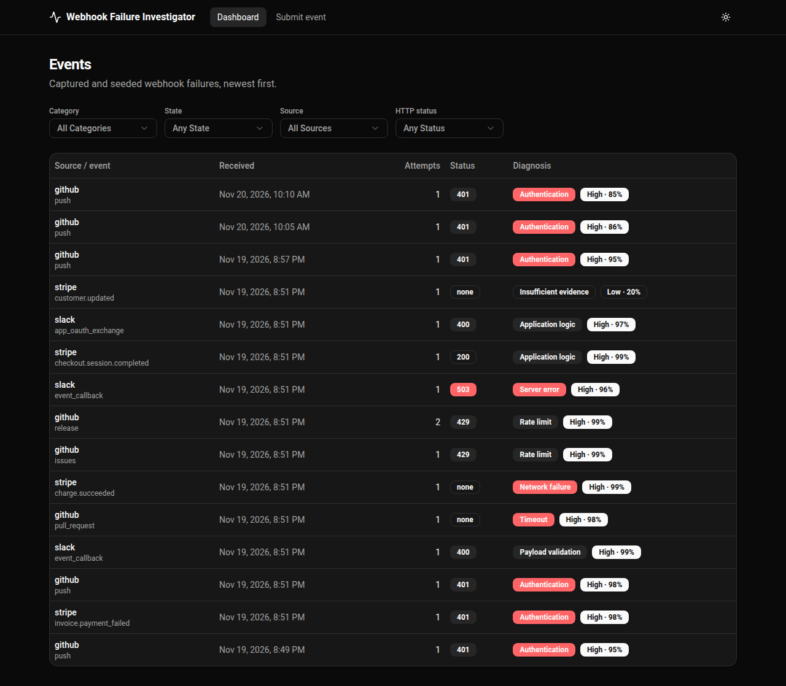
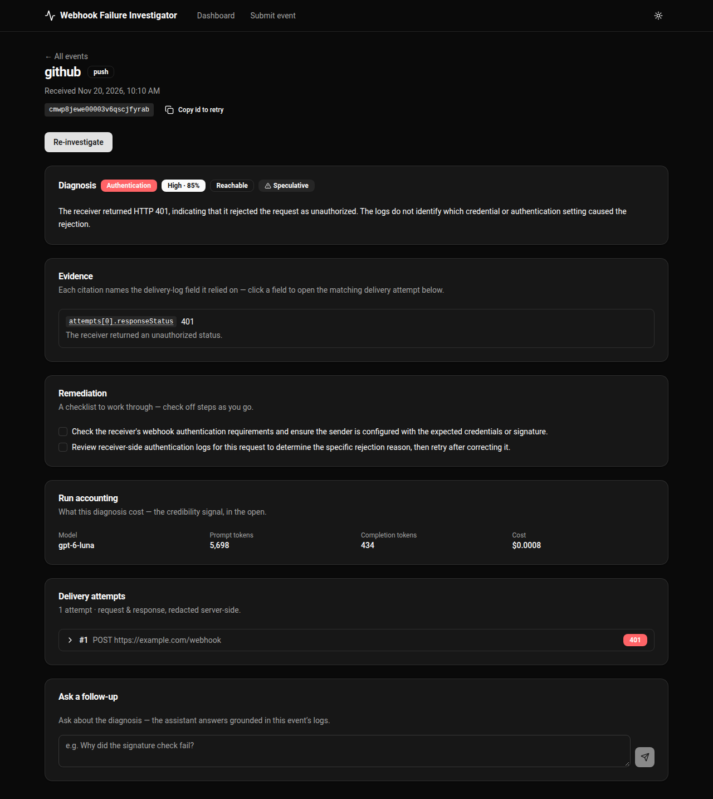
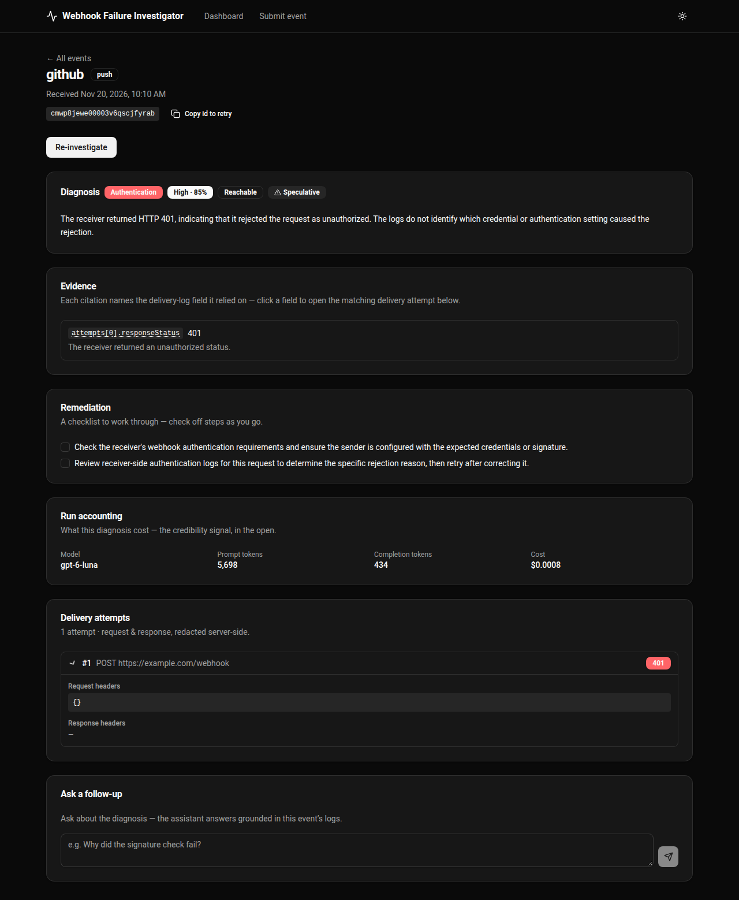
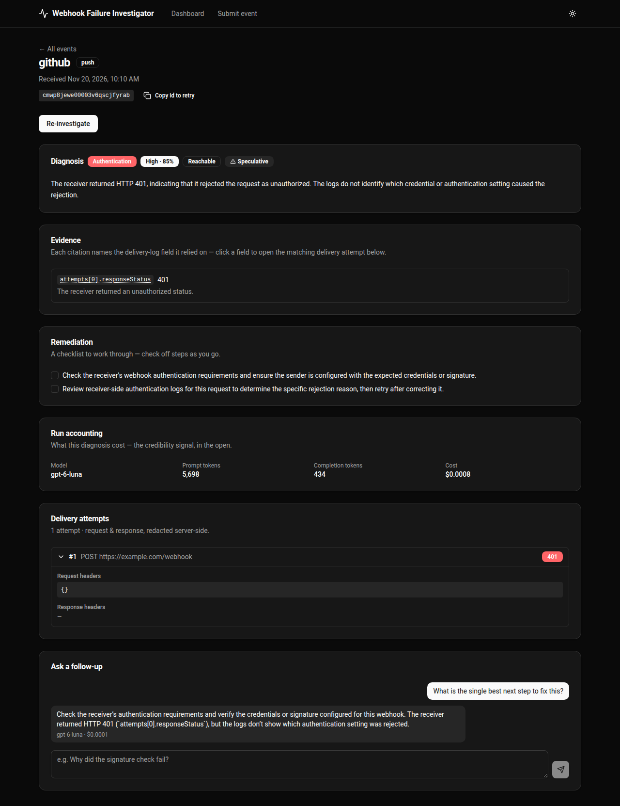
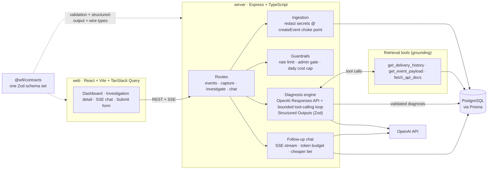

# Webhook Failure Investigator

An AI assistant that investigates failed webhook deliveries and explains what went wrong —
**grounded in the actual delivery logs, not guesses**. It classifies the failure into a defined
taxonomy, explains the root cause while citing the real request/response/log fields it relied on,
recommends concrete fixes, and answers follow-up questions with the original event held as context.
When the evidence is too thin, it returns `insufficient_evidence` rather than inventing a cause.

> **🔗 Live demo:** https://webhook-failure-investigator-production.up.railway.app/ &nbsp;·&nbsp;
> **Status:** live — Phases 1–11 complete (full stack deployed on Railway; see [docs/ROADMAP.md](docs/ROADMAP.md)).

The one hard thing this project does well is **keep the LLM honest**: every claim it makes must
cite a real log field, and that constraint is enforced structurally — by the output schema, by
tool-gated data access, and by an eval that fails when grounding regresses — not by politely asking
the model to behave.

## What this demonstrates

_(for non-technical reviewers)_ Developers who integrate third-party APIs constantly hit webhook
delivery failures, and triaging them — expired token? payload mismatch? timeout? rate limit? a bug
on the receiving end? — is tedious, repetitive work. This app takes a real failed delivery and
produces a plain-language, **evidence-cited** diagnosis plus concrete fixes, then lets you
interrogate it conversationally. It is a complete, tested, deployed full-stack product built to show
production-grade LLM engineering — structured output, tool calling, anti-hallucination grounding,
context management, cost control, and measurable quality via evals — not a prompt-in-a-box demo.

## Demo

The full flow — submit a failure → investigate → read the grounded diagnosis → click an evidence
citation to jump to the exact log field → ask a follow-up:

|                                              Events dashboard                                               |                                                             Grounded diagnosis                                                              |
| :---------------------------------------------------------------------------------------------------------: | :-----------------------------------------------------------------------------------------------------------------------------------------: |
|                  |  |
|                                       **Citation → the log it cites**                                       |                                                        **Streaming follow-up chat**                                                         |
|  |                           |

The **evidence citations** (each links to the underlying log field) and the **per-run token/cost
line** are the credibility signals: the diagnosis is accountable to the data, and what it cost is in
the open. Screenshots are captured end-to-end against a **real model** (dark theme) by
[web/e2e/screenshots.spec.ts](web/e2e/screenshots.spec.ts) — a manual
`pnpm --filter @wfi/web e2e:screenshots` run that is deliberately kept out of CI (it spends).

## Architecture



**The shared `@wfi/contracts` package is the single source of truth:** one set of Zod schemas drives
API input validation, the LLM's structured-output contract, _and_ the web wire types — so the three
can't drift. Full rationale in [docs/PLAN.md](docs/PLAN.md); phased build history in
[docs/ROADMAP.md](docs/ROADMAP.md).

## Engineering decisions

The parts a reviewer actually cares about — each tied to code you can run.

### Why structured output

A single Zod schema (`DiagnosisSchema` in [@wfi/contracts](contracts/)) drives OpenAI Structured
Outputs via `zodResponseFormat`, so the model returns a _validated_ diagnosis object — failure
category (from the 8-value taxonomy below), root cause, confidence, an `evidence[]` array citing
specific log fields, remediation steps, and a reachability assessment. **The same schema validates
API input**, which is the point: define the shape once, eliminate contract drift between the API,
the LLM, and the frontend. See [server/src/diagnosis/diagnosis.schema.ts](server/src/diagnosis/diagnosis.schema.ts)
and the Prisma-enum lock-step guard in
[server/src/domain/failure-category.ts](server/src/domain/failure-category.ts).

> **Failure taxonomy:** `authentication`, `payload_validation`, `timeout`, `network_failure`,
> `rate_limit`, `server_error`, `application_logic`, `insufficient_evidence`.

### How grounding is enforced

This is the heart of the project — hallucination is made _structurally_ hard, three ways:

1. **Schema-required citations.** `evidence[]` must reference real log fields; the UI renders each as
   a live link that opens the exact delivery attempt it cites (visible in the demo above).
2. **Tool-gated data access.** Rather than dumping raw logs into the prompt, the model retrieves data
   through bounded tools — `get_delivery_history`, `get_event_payload`, `fetch_api_docs`
   ([server/src/diagnosis/tools/](server/src/diagnosis/tools/)) — and each call is persisted as an
   `InvestigationMessage`.
3. **An explicit escape hatch.** When evidence is thin, the model must return
   `failureCategory: insufficient_evidence` with `isSpeculative: true` instead of guessing.

And it's **verified, not asserted**: the eval harness includes a deliberately weakened
`regressed-no-grounding` prompt variant and confirms the scorecard's grounding score drops when the
invariant is removed ([server/src/eval/prompt-variants.ts](server/src/eval/prompt-variants.ts)).

### Cost controls

Every model call records `model`, `promptTokens`, `completionTokens`, and `costUsd` on the
`Investigation` record ([server/src/diagnosis/pricing.ts](server/src/diagnosis/pricing.ts)) — feeding
both the UI credibility signal and a **DB-backed global daily cost cap**
([server/src/diagnosis/cost-guard.ts](server/src/diagnosis/cost-guard.ts)) that sums the day's spend
across investigations _and_ chat turns and refuses paid endpoints with a friendly `429` once over
budget. Follow-up chat runs on a configurable cheaper tier (`OPENAI_CHAT_MODEL`), there's a
per-request output-token ceiling (`OPENAI_MAX_OUTPUT_TOKENS`), and the few-shot set is curated
(deliberately not one-per-category) for prompt-cost discipline.

### Context management

Follow-up chat is multi-turn Q&A scoped to a single investigation, streamed over SSE. Each turn
enforces a **per-request token budget** ([server/src/diagnosis/token-budget.ts](server/src/diagnosis/token-budget.ts)),
summarizes/truncates long log bodies with **pointers back to the full data**
([server/src/diagnosis/chat.context.ts](server/src/diagnosis/chat.context.ts)), and replays only the
history scoped to that investigation — so a very long log thread stays within the context limit
without erroring.

## Eval scorecard

Diagnosis quality is measurable and regression-safe. The harness scores **classification accuracy**
(overall + per-category), **grounding** (does the answer cite the expected real fields?), and
**confidence calibration** against a labeled scenario set, tagged by prompt version. Methodology and
the full diffable reports live in [docs/eval/](docs/eval/).

<!-- EVAL_SCORECARD:START — headline from the committed docs/eval/diagnosis-v2-*.md (live run); regenerate with `pnpm eval` -->

**Prompt `diagnosis-v2` · model `gpt-6-luna` · 11 labeled scenarios · live run**

| Metric                        | Score                                        |
| ----------------------------- | -------------------------------------------- |
| Classification accuracy       | **90.9%** (10/11)                            |
| Grounding pass rate           | **100%** (11/11) · 96.7% mean field coverage |
| Insufficient-evidence refusal | **1/1** refused correctly                    |
| Confidence calibration        | **100%** OK                                  |
| Cost for the full run         | **$0.0087** (68.6k tokens)                   |

The single miss is an honest one — a redacted-secret payload classified as `application_logic`
rather than `payload_validation`; it still cited real evidence (grounding passed). Full per-scenario
rows and the machine-readable report:
[docs/eval/diagnosis-v2-2026-11-20T03-52-23Z.md](docs/eval/diagnosis-v2-2026-11-20T03-52-23Z.md).
<!-- EVAL_SCORECARD:END -->

Run it yourself — `pnpm eval` (real, needs a key) or `WFI_FAKE_LLM=1 pnpm eval` (plumbing check, no
spend). See [docs/eval/README.md](docs/eval/README.md).

## Prerequisites

**Docker-only** — enough to run and develop the app:

- **Docker** (with the Compose v2 plugin) — `docker compose up` builds and runs postgres + server + web; migrates + seeds on first boot, hot-reloads your edits, and works with no `.env` (fake-LLM mode).

**Host dev loop (optional, faster inner loop)** — adds, on top of Docker:

- **Node 22** (see [.nvmrc](.nvmrc)) — `nvm use`
- **pnpm 9** — `corepack enable`

Run the app on the host via `pnpm dev` with only Postgres containerized. This is the faster edit loop and is required for the `pnpm` convenience scripts; see [Quickstart](#quickstart) for both paths.

## Quickstart

Two supported workflows — the full stack in Docker, or the fast host loop with only Postgres in a
container.

### Full stack in Docker (one command)

```bash
cp .env.example .env    # local dev defaults (edit as needed)
docker compose up       # postgres + server + web; migrates + seeds on first boot
```

- Web: http://localhost:5173
- Server health check: http://localhost:3000/health

By default the stack runs with `WFI_FAKE_LLM=1` — a deterministic fake LLM, so it comes up with no
OpenAI key and no spend. For live diagnosis, set a real `OPENAI_API_KEY` in `.env` and `WFI_FAKE_LLM=0`.

Tear down with `docker compose down` (add `-v` to also drop the Postgres data + `node_modules` volumes).

> **Changed a dependency?** The container's `node_modules` live in named volumes that Docker only
> populates on first creation, so `docker compose up --build` alone won't pick up a new/upgraded
> package — the containers keep the stale volume. After editing `package.json`/`pnpm-lock.yaml`,
> refresh the volumes first:
>
> ```bash
> docker compose down                     # or: docker compose stop
> docker volume rm webhook-failure-investigator_wfi_root_node_modules \
>   webhook-failure-investigator_wfi_server_node_modules \
>   webhook-failure-investigator_wfi_web_node_modules   # keeps wfi_pgdata (your DB data)
> docker compose up --build
> ```
>
> `docker compose down -v` does the same but also drops `wfi_pgdata` (your captured events + investigations).

### Host dev loop (Postgres-only container)

Fastest edit loop — run the app on the host and containerize only the database:

```bash
pnpm install                 # install workspace dependencies
cp .env.example .env         # local dev defaults (edit as needed)
docker compose up -d postgres  # start ONLY Postgres
pnpm dev                     # run server + web on the host
```

Same URLs as above. Here the app reaches Postgres on `localhost` (the `DATABASE_URL` in `.env`); in
the full-stack container it reaches it on `postgres:5432` (set by `docker-compose.yml`).

> If host port 5432 is already in use, set `POSTGRES_PORT` in `.env` (and update `DATABASE_URL` to match).

> Set up the database, then load the scenario library (host-dev path only — the full-stack container
> migrates + seeds automatically on first boot):
>
> ```sh
> pnpm --filter @wfi/server prisma migrate dev   # create/apply the schema
> pnpm --filter @wfi/server db:seed              # load 11 labeled failure scenarios (idempotent)
> ```
>
> Seeded events use stable `seed_*` ids (e.g. `GET /events/seed_stripe_auth_401`); re-running `db:seed` refreshes them without touching live-captured events.

> Investigate a stored event (requires `OPENAI_API_KEY` in `.env` — this makes a real, billed model call):
>
> ```sh
> curl -XPOST localhost:3000/events/seed_stripe_auth_401/investigate   # → 201 with a grounded diagnosis
> curl localhost:3000/events/seed_stripe_auth_401/investigations        # prior runs, newest-first
> ```

## Commands

| Task      | Command          |
| --------- | ---------------- |
| Install   | `pnpm install`   |
| Dev (all) | `pnpm dev`       |
| Typecheck | `pnpm typecheck` |
| Lint      | `pnpm lint`      |
| Format    | `pnpm format`    |
| Test      | `pnpm test`      |
| Build     | `pnpm build`     |
| Run evals | `pnpm eval`      |

### Common tasks (Docker + DB)

Convenience scripts that front the multi-step container/database sequences:

| Task                              | Command               | What it does                                                                                                 |
| --------------------------------- | --------------------- | ------------------------------------------------------------------------------------------------------------ |
| Full stack (containers)           | `pnpm docker:up`      | `docker compose up --build` — postgres + server + web; migrates + seeds on first boot.                       |
| Postgres only (host-dev loop)     | `pnpm docker:db`      | `docker compose up -d postgres`, then run `pnpm dev` on the host.                                            |
| Refresh after a dependency change | `pnpm docker:refresh` | Tears down and drops the `node_modules` volumes (keeps `wfi_pgdata`) before rebuilding — see the note below. |
| Reset the DB schema + seed (host) | `pnpm db:reset`       | `prisma migrate deploy` + idempotent `db:seed` against the host-reachable Postgres.                          |

> **Why `docker:refresh`?** The container's `node_modules` live in named volumes that Docker only
> populates on first creation, so `docker compose up --build` alone won't pick up a new/upgraded
> package. Run `pnpm docker:refresh` after editing `package.json`/`pnpm-lock.yaml`. It preserves your
> Postgres data; `docker compose down -v` would also wipe that.

### Don't source `.env` into your shell

The app loads `.env` itself (via dotenv in `server/src/config/env.ts`), and `docker compose` reads it
directly — nothing you run by hand needs those vars exported. **Do not** `set -a; . ./.env` or
`export` its contents into your interactive shell: dotenv never overrides a variable already present
in the environment, so a stale export silently wins over the file. Two ways this bites:

- A leftover `DATABASE_URL` makes the app ignore the port in `.env` and connect to the wrong Postgres.
- A leftover **`NODE_ENV=development` makes `pnpm build` produce a development bundle** (React & friends
  ship larger dev builds), which fails the web bundle-budget gate with a confusing "Initial-load JS
  budget exceeded" error.

If a build or DB connection behaves unexpectedly, check the shell is clean and clear any leftovers:

```bash
env | grep -E 'NODE_ENV|DATABASE_URL|POSTGRES'   # expect no output for host dev
unset NODE_ENV DATABASE_URL                       # or just open a fresh terminal
```

## Deploying to Railway

Phase 10 takes the stack to a live, hardened URL on **Railway** as a **single service** — the server
serves the compiled web bundle on one origin (no separate web host, no CORS, SSE just works) with
**managed Postgres** alongside. The Phase 10 checklist (deploy + hardening) lives in
**[docs/ROADMAP.md](docs/ROADMAP.md)**. In brief:

- **Build:** Railway builds `server/Dockerfile`'s final stage (`runtime`) from the repo root. That
  image builds `web/dist`, runs as non-root, and its entrypoint (`server/docker-entrypoint.prod.sh`)
  runs `prisma migrate deploy` before booting — never seeds. Mirror it locally with
  `pnpm --filter server migrate:deploy`.
- **Env/secrets** (server service): `DATABASE_URL` (a Railway reference to the Postgres service),
  `OPENAI_API_KEY`, `NODE_ENV=production`, `ADMIN_API_TOKEN`, `OPENAI_DAILY_COST_CAP_USD`,
  `OPENAI_MAX_OUTPUT_TOKENS`. Leave `WFI_FAKE_LLM` unset so real diagnoses run. `PORT` is injected by
  Railway. See `.env.example` for what each does.
- **Hardening (open-demo + caps):** investigate/chat/manual-submit stay public, protected by per-IP
  **rate limiting** + a **global daily OpenAI cost cap** (friendly 429 when hit). A shared **bearer
  token** guards only `POST /capture-endpoints`. `helmet` + `trust proxy` are on; request logging
  (`pino`) redacts auth headers; secrets are redacted before storage **and** logs.
- **Local prod-parity smoke:** `docker build -f server/Dockerfile --target runtime -t wfi-prod .`,
  then run it against a local Postgres with `NODE_ENV=production` and the caps set, and hit
  `http://localhost:<port>/` — the UI should load from the server origin.

## Layout

```
/server      Express + TypeScript API — Prisma, OpenAI (Structured Outputs + tool calling), chat
/web         React + TypeScript + Vite frontend
/contracts   @wfi/contracts — the shared Zod schemas (single source of truth)
/docs        PLAN.md, ROADMAP.md, planned-ci.md, eval scorecards, demo assets
/.claude     Claude Code developer tooling
```
